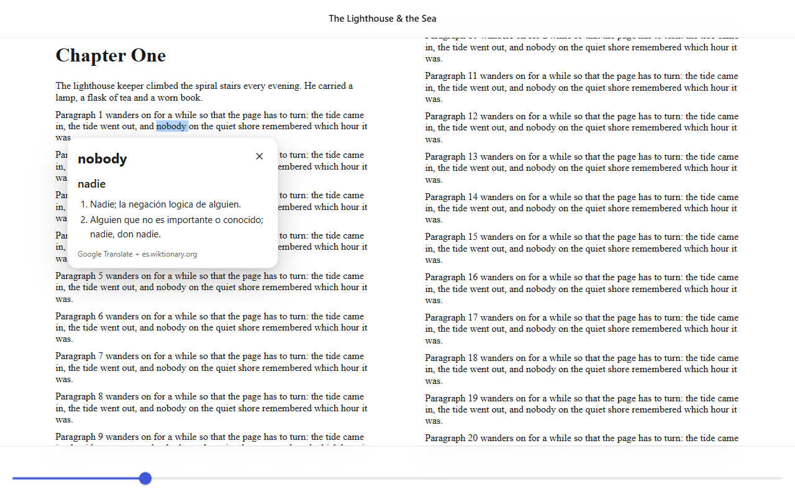

<div align="center">


# simple-reader

**A clean, local-first EPUB and PDF reader. Select a word, get the definition, the Spanish translation and, for Japanese, the reading.**

[](https://github.com/ShiroKuro-hen/simple-reader/actions/workflows/ci.yml)
[](LICENSE)
[](https://www.typescriptlang.org/)
[](https://vitejs.dev/)
[](#contributing)

**[Try it online](https://shirokuro-hen.github.io/simple-reader/)** · your books never leave your device



</div>

## Why simple-reader

Most readers either do a lot and get in the way, or do little and send your library to someone else's server. simple-reader aims at the middle: a quiet reading view, instant word lookup for language learners, and your books kept as plain files on your own device. No account, no database, no tracking.

## Features

- **EPUB and PDF** in one reader (EPUB rendered with foliate-js, PDF with PDF.js).
- **Clean paginated reading** with light, dark and sepia themes and adjustable font size.
- **Select any word to look it up:** definition and Spanish translation in a popup.
- **Japanese support:** hiragana reading and romaji on select, plus a furigana-over-kanji mode.
- **Local-first:** books are files on your device (browser OPFS). No account, no database.
- **Optional backup/sync** to your own free Cloudflare R2 bucket. It never deletes anything, and the newest reading progress wins.
- **Runs as a web app** in the browser.

| Platform | Status |
|---|---|
| Web app | Available (v0.1) |
| Installable PWA / offline | Planned |
| Desktop (Windows, macOS, Linux) via Tauri v2 | Planned |
| Android APK via Tauri v2 | Planned |

## Quick start

```bash
npm install
npm run dev      # start the dev server
npm run build    # typecheck and build to dist/
```

Run the tests with `npm test`.

## Usage

Open an EPUB or PDF from the library screen (file picker or drag and drop). Select a word or phrase to open the lookup popup. Theme, font size and furigana mode live in the settings panel. Your last position in each book is remembered.

| Action | Keys |
|---|---|
| Next page | `→`, `PageDown`, `Space`, or click the right edge |
| Previous page | `←`, `PageUp`, `Shift+Space`, or click the left edge |
| Close the popup / show or hide the toolbars | `Esc` |
| Show the toolbars | `Tab` (on touch: tap the middle of the page) |

Right-to-left and vertical books are not handled yet: the page-turn keys assume left-to-right.

## Cloudflare R2 setup (optional sync)

Backup copies your library (books, metadata, reading progress, settings) to a bucket you own. R2 has a free tier that is plenty for a personal library.

1. In the Cloudflare dashboard, go to **R2** and create a bucket (for example `simple-reader`). Note your **Account ID**, shown on the R2 overview page.
2. Create an **API token** (R2 > Manage API tokens) with **Object Read & Write** permission for that bucket. Copy the Access Key ID and Secret Access Key.
3. Add a **CORS rule** to the bucket (Settings > CORS policy); without it the browser blocks the requests. Paste this, replacing the origin with the address where you run the app (`https://shirokuro-hen.github.io` for the hosted version) (the rule is generated by `describeCors()` in `src/sync/r2.ts`, and network errors repeat it):

   ```json
   [
     {
       "AllowedOrigins": ["http://localhost:5173"],
       "AllowedMethods": ["GET", "PUT", "HEAD"],
       "AllowedHeaders": ["*"],
       "ExposeHeaders": ["ETag"],
       "MaxAgeSeconds": 3600
     }
   ]
   ```
4. In the app, open **Settings** and paste the account ID, bucket name, access key ID and secret access key.
5. Press **Back up now** to upload your library. On another device, enter the same settings and press **Restore** to bring it over.

Your keys stay in your browser only; they are used to sign requests to Cloudflare and go nowhere else. Neither button ever deletes anything on either side. For the small JSON files (metadata, progress) the newest one wins, so two devices do not overwrite each other's progress.

## How Japanese lookup works

Japanese text is analysed in the browser with [kuroshiro](https://github.com/hexenq/kuroshiro) and the [kuromoji](https://github.com/takuyaa/kuromoji.js) morphological analyser. The dictionary is large, so it is loaded on demand the first time you look up Japanese. Readings come out as hiragana and romaji, and the furigana mode adds `<ruby>` annotations over kanji in the page. Japanese definitions come from a trimmed [JMdict](https://www.edrdg.org/jmdict/j_jmdict.html) (built from [jmdict-simplified](https://github.com/scriptin/jmdict-simplified), about 2 MB gzipped) that ships with the app. Entries without a Spanish gloss are translated online.

**Network use.** Looking up a word calls public services from your browser: the built-in Chrome translator when available, then Google Translate's unofficial `translate.googleapis.com` endpoint, then MyMemory for translations, and es.wiktionary for Spanish definitions. The selected word (and nothing else) is sent. That Google endpoint is not an official API and may change or rate-limit; Japanese reading and romaji keep working offline. Run `LIVE=1 npx vitest run src/lookup` to check the providers still respond.

## Roadmap

Taken from [PLAN.md](PLAN.md) (written in Spanish). Checked means it exists today.

- [x] Web app skeleton (Vite + TypeScript, single `Storage` interface)
- [x] Open EPUB and PDF, paginated reading, themes, font size, remember position
- [x] Word lookup with Spanish translation, Japanese reading, romaji and furigana
- [x] Optional R2 backup and sync
- [ ] Library: import folders, tags and shelves, search across books
- [ ] Highlights, notes and bookmarks
- [ ] Scriptable core: CLI, local API, export templates, rules
- [ ] Deep customisation: custom CSS, reading profiles, remappable keys, user dictionaries
- [ ] PWA with offline support
- [ ] Desktop and Android builds with Tauri v2
- [ ] Other sync backends (WebDAV, shared folder) and OPDS
- [ ] Extras: TTS, MOBI/FB2/CBZ, OCR

## Tech stack and credits

- [TypeScript](https://www.typescriptlang.org/) and [Vite](https://vitejs.dev/), no UI framework
- [foliate-js](https://github.com/johnfactotum/foliate-js) (MIT) for EPUB rendering
- [PDF.js](https://github.com/mozilla/pdf.js) (Apache-2.0) for PDF rendering
- [kuroshiro](https://github.com/hexenq/kuroshiro) and [kuromoji](https://github.com/takuyaa/kuromoji.js) for Japanese readings
- [aws4fetch](https://github.com/mhart/aws4fetch) for signing S3 requests
- [Cloudflare R2](https://developers.cloudflare.com/r2/) for optional storage
- [JMdict](https://www.edrdg.org/jmdict/j_jmdict.html) © the [Electronic Dictionary Research and Development Group](https://www.edrdg.org/), used under [CC BY-SA 4.0](https://www.edrdg.org/edrdg/licence.html); [jmdict-simplified](https://github.com/scriptin/jmdict-simplified) for the JSON conversion
- [Wiktionary](https://es.wiktionary.org) definitions, CC BY-SA, fetched at lookup time
- Translations via Google Translate (unofficial endpoint), MyMemory and the Chrome built-in Translator when available

## Contributing

Issues and pull requests are welcome.
Open an issue first for anything big so we can agree on the approach.
Run `npm run typecheck` and `npm test` before sending a PR. Tests avoid mocks: domain rules are pure functions tested with real data, and browser behaviour is checked in a real Chromium (see `e2e/`). To try the reader on a real book of your own, set `REAL_EPUB` to its path for the opt-in specs; never commit books.

## License

[MIT](LICENSE) (c) 2026 ShiroKuro-hen
